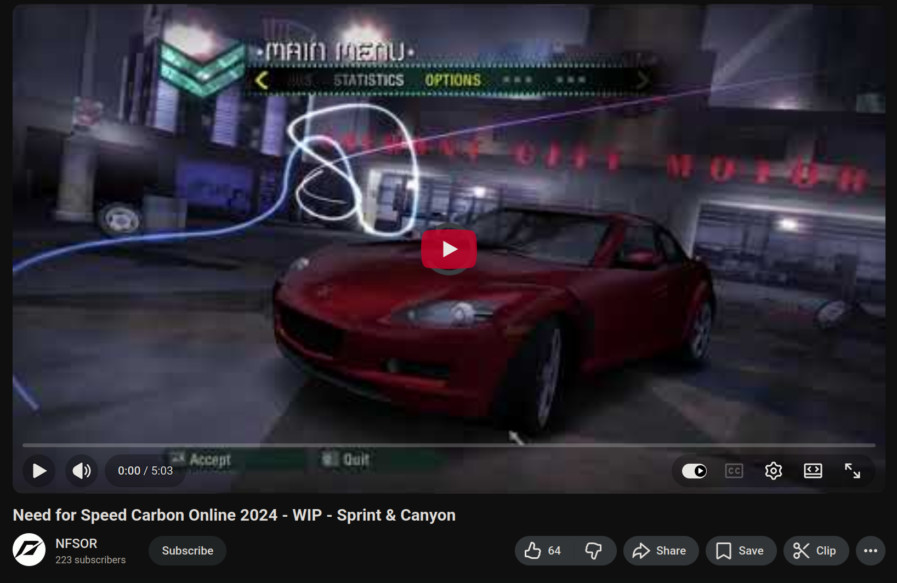
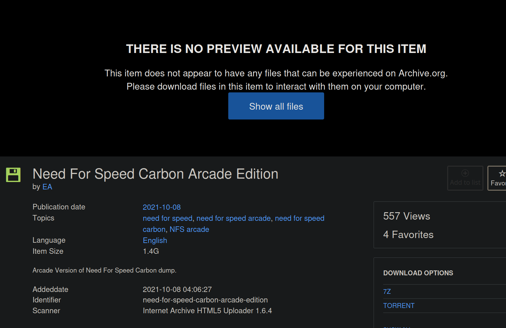
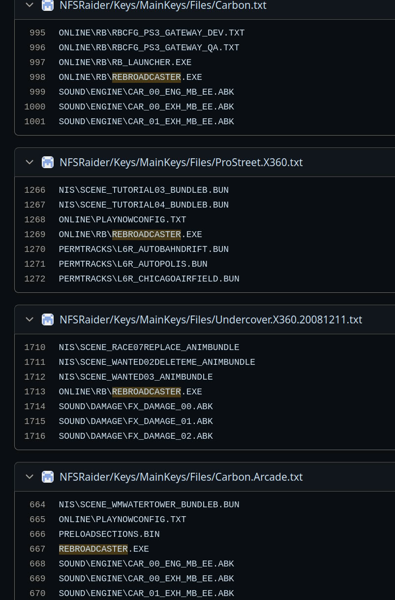
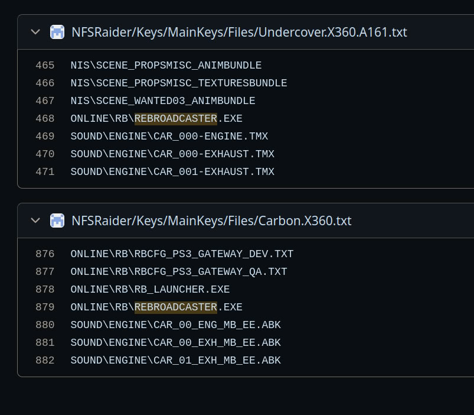
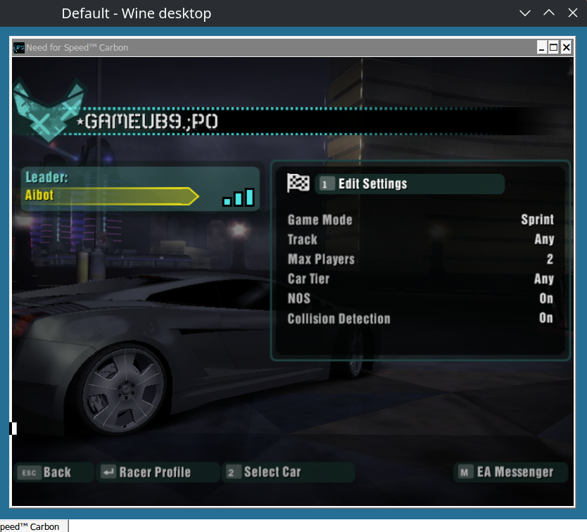
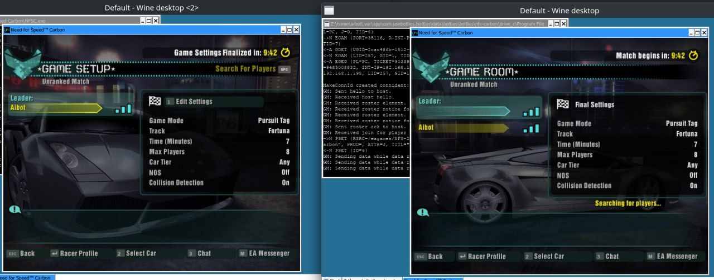
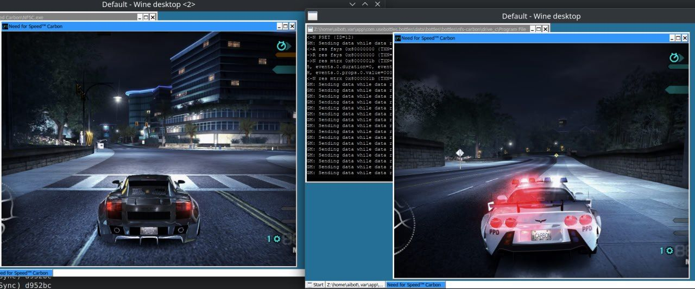
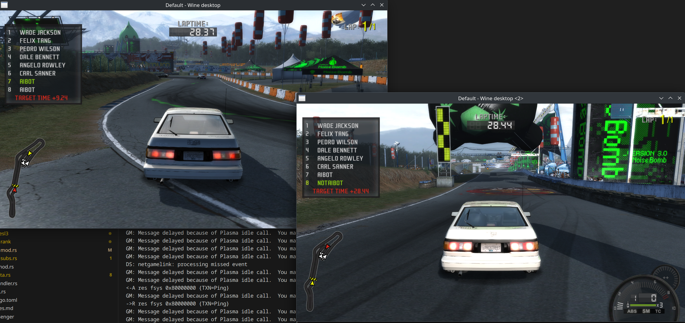
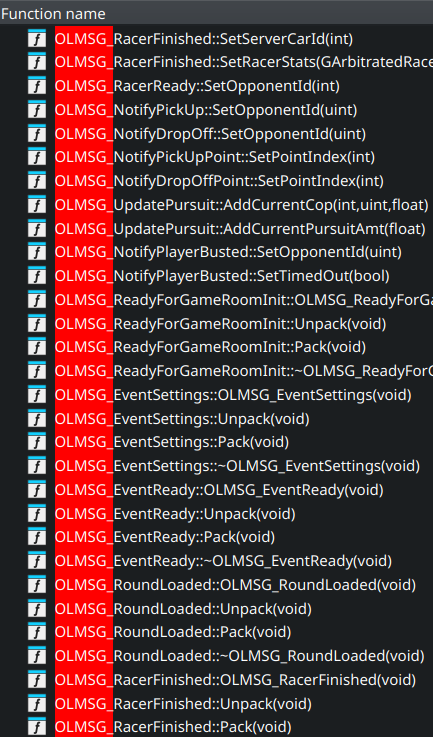

# How (some) NFS games came back to life via an oversight from EA 

In our restless pursuit of knowledge in the reverse engineering field we're often betting on luck in the form of "educated guesses". `10% luck, 20% skill`, as Fort Minor said. This is a story slash brief technical analysis about a particular part of EAs legacy.

# Summer 2025

Need For Speed games from the 00s era happen to be part of my childhood, so they have a very special place in my heart. And as a guy reviving games, bringing them back online was my dream since the day I made it my go-to pastime. 

And so back in the summer of 2025 during a quiet period in my development and research endeavors I decided to do some work in that department, starting with Need For Speed Carbon. My partner in crime, halvors, and I quickly hacked together a rather simple FESL/Plazma server, based on numerous other implementations and existing packet logs. (Thanks, Faith and Xan.)

> To save you from confusion going forward, Plazma is FESL, but fesl is not Plazma. Back in 2005 EA created an online network middleware system for their games, called FESL. FESL consists of three main servers: fesl, theater, and messenger. There are technically more, but those are used on a per-title basis. Later, they renamed FESL into Plazma, while keeping fesl, theater and messenger. So for FESL as a service I'll use capitalization, and for fesl as a server I will use no capitalization.

We passed authentication with ease, implemented a matchmaking service and then we hit a wall. The game required a dedicated game server to function and couldn't create sessions on its own, as we were used to doing with other P2P games of this era. 


```
<-U GDAT {JP=0, F=0, HN=nfsdevserver, B-U-matchmaking_state=0, N=NA1CarbonPC-02-08, B-U-team_play=1, I=159.153.43.197, J=C, HU=799270239, B-U-car_tier=1, V=1.0, P=19007, B-U-game_mode=1, TYPE=G, LID=257, B-U-help_type=0, B-U-player_dnf=49, B-version=298_prod_server+22012b18, B-U-max_online_player=2, B-U-n2o=0, B-U-track=, QP=0, MP=2, B-U-collision_detection=0, B-U-version=298_prod_server+22012b18, B-U-race_type_sprint=ABSTAIN, B-U-race_type_pursuit_tag=ABSTAIN, GID=235259, NF=0, PL=PC, PW=0, TID=4, B-U-race_type_speedtrap=ABSTAIN, B-U-skill=0, B-U-game_type=1, B-U-race_type_canyon_due=ABSTAIN, B-U-race_type_circuit=ABSTAIN, AP=0, B-U-race_type_knockout=ABSTAIN, B-U-length=4}
<-U GDAT {JP=0, F=0, HN=nfsdevserver, B-U-matchmaking_state=0, N=NA2CarbonPC-02-015, B-U-team_play=1, I=159.153.164.148, J=C, HU=799270239, B-U-car_tier=2, V=1.0, P=13182, B-U-game_mode=13, TYPE=G, LID=257, B-U-help_type=0, B-U-player_dnf=50, B-version=298_prod_server+22012b18, B-U-max_online_player=2, B-U-n2o=0, B-U-track=, QP=0, MP=2, B-U-collision_detection=0, B-U-version=298_prod_server+22012b18, B-U-race_type_sprint=ABSTAIN, B-U-race_type_pursuit_tag=ABSTAIN, GID=235266, NF=0, PL=PC, PW=0, TID=4, B-U-race_type_speedtrap=ABSTAIN, B-U-skill=500, B-U-game_type=1, B-U-race_type_canyon_due=2.duel, B-U-race_type_circuit=ABSTAIN, AP=0, B-U-race_type_knockout=ABSTAIN, B-U-length=1}
...
```

According to existing packet captures there were a lot of dedicated servers. Well, we *theorized* that those were dedicated servers. You see, the culprit is a particular service on the fesl server, called `pnow`.

`pnow` serves as a matchmaking queue, but it can also return 

```
    NOMATCH,
    NOSERVER,
    JOIN,
    LIST,
    CREATE,
    CreateProxy, //FESL 3 and onwards
```

Since we knew that under normal conditions, the server returns `JOIN` to point the client toward a server, I thought that maybe the `CREATE` call can be used to create a local P2P session. Well, it sadly did nothing even after a week of work to make it do *something*. So after some more work we gave up, labeled the project as "impossible for now", and put it away, moving on to work on more promising games.

# 3 more things

As it usually goes, putting a project on a shelf in defeat does not ease your mind. You're still wondering if you somehow missed something, or maybe there is more to it. During such times I usually just Google things, search GitHub for code, or dig through the Web Archive.

And so I found three things:

## A video of working Carbon online



https://www.youtube.com/watch?v=r6iE9e_ElQw

I happened to come across a video from 2024, where two people from the NFSOR project managed to make the game run and play one online game.

This meant that the whole project was, in fact, possible. This left me with two possibilities:

- Those guys were geniuses and had made their own server
- They knew something I didn’t.

In the end I never asked anybody from NFSOR about anything, because the project appeared dead (it does have a working server, so, go figure) and because I was unable to locate the developers. Plus I didn't want to let anybody know I was working on it.

## NFS Carbon `server.dll`

There is a `server.dll` in all copies of the game. And it's known from Most Wanted that this is a LAN server, which is somewhat usable (https://github.com/xan1242/NFSLAN). So I tried to do the same thing for Carbon, and although I made it boot, it didn't do anything beyond that.

## NFS Carbon Arcade version



On the Web Archive there is a dump of NFS Carbon for arcade cabinets, which is a modified version of the PC game.

The curious thing about it is that there is a `server` checkbox in the launcher, which looked promising to me. So I spent another week digging into it, capturing packets and trying everything to make it work with a regular PC version. It never worked.

There was also a binary named `rebroadcaster.exe` which I never bothered to put into a decompiler, since I thought it was just some arcade-cabinet stuff. 

And after that I finally gave up, putting an end to my NFS Carbon revival attempts.

# January 2026

I sometimes host `Game Days` for my friends and myself. And in January, we decided to include NFS ProStreet as one of the games. During my initial preparations I navigated to `ONLINE` dir in the game directory, and to my surprise I saw

`rebroadcasterlan.exe`

just sitting there, looking at me funny, tempting me into another manic episode. I'm a human after all, so I gave in.

I hastily opened the manual, it said something about launching `bombd.exe` and then `rebroadcasterlan.exe`. Just as swiftly, I put the binary into a decompiler to confirm what my gut was telling me. And then I saw it - mentions of `FESL`. Some more experiments with ProStreet itself showed that rebroadcasters were `rooms`, but the client controlled those rooms. And it all finally clicked.

**EA never hosted dedicated servers!** There were no dedicated servers. What they hosted was an army of rebroadcasters, which are just a TURN server, funneling your local traffic through EA’s servers. This meant that I somehow needed to pair a FESL server with a rebroadcaster and that's it! And I just so happened to have a `rebroadcaster.exe` for NFS Carbon! I had everything to make it work!

# 1 week later

I didn't have everything to make it work.

Yes, I made `rebroadcaster.exe` from the Carbon Arcade version to connect to my FESL server after a lot of fixes to the server. But for whatever reason, the game just refused to work with it. I could see packets, but neither the game nor the rebroadcaster showed any signs of being interested in connecting to each other. No amount of spoofing did anything.

I was once again considering giving up, since although I got an answer to that mystery and while writing my own rebroadcaster was doable, it could take months and I obviously wanted the results now.

So I once again decided to Google, and to my surprise I did find *something* that would change NFS games forever (pardon waaay out of hand clickbate-y wording, couldn't help myself).

# Are you good with estimates?

Searching for `rebroadcaster` on GitHub brought a handful of results, which I doomscrolled through with exactly zero hope. Let's keep it real - the chances of a proprietary piece of EAs software leaking are low. Yes, there're particular cases, but usually, if such a thing had happened every NFS community under the sun would have known about it.

But on the second page I saw **it**. And I couldn't believe my eyes.

In a repository at https://github.com/Felipe379/NFSRaider whose purpose is not exactly understood by me, there were lists of files from each version of NFS from the Black Box era. And in those lists there was





***SO***

What is the chance, that Carbon, ProStreet and Undercover copies of the games for Xbox 360 (and Carbon for PC, but more about it later) contain a Windows binary on them?

What is the chance that 15 million sold Xbox 360 discs contained the missing piece, crucial for those games online revival?

What is the chance that a Windows binary ended up in the master disc image not once, but 3 times?

What is the chance that nobody in the past 20 years connected the dots and figured out what rebroadcaster does?

What is the chance of all four of those things happening together?

**Zero?** Less than zero?

Surprisingly, it's not. 

I took a long look at that list in that repo, while I slowly processed what I just found, before getting back to work.

# Making it all work

Since the repository clearly stated that Carbon for PC had that file, I checked my version. And to my surprise the damn file was sitting there, mocking me. Unfortunately, the binary from my copy was corrupted and refused to start. So I just dumped my very own Xbox 360 disc, extracted the `rebroadcaster.exe`, and seeing it run properly gave me hope.

More work, more code, fixes, more fixes. And after four hours, I was presented with a screen.



More work, very crude support for more than one person on the server, and as a result





Five years after its closure, the game was running once again due to pure luck and some great people documenting a list of files on each copy’s disc of the game.

After that, I spent 5 more months working on FESL server and its components, bringing the server from a POC to a working implementation suitable for public usage. It was a lot of pain.

> Expect yet another write-up about the whole process and FESL server internals, where I will describe in great detail why I hate EA programmers, like FESL and what is what in this bizarre universe.

### 2 more things

Regarding the rebroadcaster in the PC version of Carbon - it does exist and does work, but the only working sample exists in the Japanese copy of the game, which exists on the Web Archive.

While sharing knowledge with Xan, it turns out that the rebroadcaster’s existence and potential purpose were known for quite a while, but nobody had made anything of it. So I'm still the very first. Or at least the first to make it fully work.

# What about other games?



NFS ProStreet was tested and it works! Undercover hasn’t been tested yet! There is much more to uncover about rebroadcaster, but that will require more months and more research. And you can learn more by reading the rest of the text.

> This is the end of the exciting part! Thanks for reading it. The rest is for people who are interested in the technical details.

# What is rebroadcaster?

Well, on paper it's a rather simple thing at 700 KB in size. Its main purpose is to create a "fake" session on the server, and then rebroadcast the game packets from the host to all connected users and back.

## Why rebroadcaster?

Back in the 2000s hosting dedicated servers for players wasn’t the norm and a very costly endeavor, so game developers and publishers mainly used P2P in their titles. Alternatively, they used dedicated servers supplied to the public.

But EA decided that P2P was not what it wanted to use, for whatever reason, but it still wanted the benefits of P2P. And so an idea to keep the user as the host, but route traffic from the user through EA’s servers, meaning you get a dedicated-server-like, hassle-free player connectivity, since NAT punching is unnecessary, at a fraction of the cost. The only thing that suffers is latency, but with a number of players on one continent it's not such a big problem.

And so this solution was born!

## What games use it?

At this point, there are five known titles:

- NFS Carbon
- NFS ProStreet
- NFS Undercover
- Burnout Paradise (https://web.archive.org/web/20080606083227/http://www.criteriongames.com/article.php?artID=91)
- Team Fortress 2 PS3 (more about that later)

But if I'm to speculate there are many more titles using rebroadcaster from the 2005–2010 era yet to be found. And this brings up a question...

# How does it work?

There are 3 main components to rebroadcaster:

- FESL client
- `ProtoTunnel` protocol
- online messages

The FESL protocol is self-explanatory and doesn't require any introduction. There is a server and a client, and they communicate.

# Online Messages

I’m beginning my explanation with messages and not the protocol, since the protocol will require additional explanation.

Rebroadcaster (at least in the NFS case) is a rather simple entity communicating with a game client via a predefined list of messages, which can be found in the code by searching for `OLMSG_`



those packets’ payloads are hardcoded, and packed into bits in a more or less simple way

```C++
  this->MessageType = v5;
  if ( !v3 )
  {
    bAssertFailPrint(
      "MessageType == OLMSGType_EventSettings",
      "Z:\\MW2\\Branches\\PostAlphaMln\\Speed\\Indep\\Src\\Online/OnlineMessage.hpp",
      836);
    DebugBreak();
  }
  v5 = 0;
  BitStream::GetBits(p_bitstream, &v5, 32);
  v6[0] = 0;
  this->mEventId = v5;
  BitStream::GetBits(p_bitstream, v6, 32);
  v5 = 0;
  this->mEventType = v6[0];
  BitStream::GetBits(p_bitstream, &v5, 1);
  v6[0] = 0;
  this->mPublic = (_cntlzw(v5 - 1) & 0x20) != 0;
  BitStream::GetBits(p_bitstream, v6, 1);
  v5 = 0;
  this->mGameRanked = (_cntlzw(v6[0] - 1) & 0x20) != 0;
  BitStream::GetBits(p_bitstream, &v5, 32);
  v6[0] = 0;
  this->mMinPlayers = v5;
  BitStream::GetBits(p_bitstream, v6, 32);
  v5 = 0;
  this->mNumRounds = v6[0];
  BitStream::GetBits(p_bitstream, &v5, 32);
  v6[0] = 0;
  this->mNumLaps = v5;
  BitStream::GetBits(p_bitstream, v6, 1);
  v5 = 0;
  this->mTeamBased = (_cntlzw(v6[0] - 1) & 0x20) != 0;
  BitStream::GetBits(p_bitstream, &v5, 1);
  v6[0] = 0;
  this->mCollisions = (_cntlzw(v5 - 1) & 0x20) != 0;
  BitStream::GetBits(p_bitstream, v6, 32);
  v4 = v6[0];
  v6[0] = 0;
  this->mCarTier = v4;
  BitStream::GetBits(p_bitstream, v6, 1);
  this->mNOS = (_cntlzw(v6[0] - 1) & 0x20) != 0;
}
```

And so in the NFS case the client connects to rebroadcaster instance, performs the handshakes and initial setup, and then just distributes state packets between clients. Simple enough.

# ProtoTunnel

During my work on `rebroadcaster.exe` from Carbon Arcade I was able to pinpoint the sending function, figure out it was using RC4 encryption, and dump some decrypted packets, which led me nowhere. But I made a mental note about it.

Later on I got back to it, in order to research the question ‘How do clients communicate in NFS Carbon?’ and that led me to `ProtoTunnel`. Basically, it's yet another custom UDP-based protocol, which is used in some EA games from that era.

The protocol itself is really convoluted and not very user-friendly.

A decrypted packet looks like:

`0000006700c1005af00d6200000000012b58dc9d00000000`

where

`0000` is an RC4 stream offset, measured in 4-byte units
`006700c1005af00d6200000000012b58dc9d00000000` is the decrypted tunnel body

In an encrypted packet the headers are encrypted, and depending on the port, the payload data can be encrypted too.

Then we parse the payload as

`0067 00c1005af00d6200000000012b58dc9d00000000`

`0067`

```
byte0 byte1

length = (byte0 << 4) | (byte1 >> 4)

port = byte1 & 0x0f
```

This means that the first 12 bits represent the payload size and the last four bits represent the port ID (yes, there are virtual ports). The 2-byte header itself is not included in that size.

So, for example:

```
0067

Decoded: 
length = 0x006 = 6
port = 0x7 = 7
```

There could be several logical packets in a single UDP payload. This is where the format gets a little weird: ProtoTunnel puts all 2-byte headers first and all packet data after them. So it looks like `header, header, payload, payload` , instead of something making sense.

For example:

```
0000 0067 00c1 005af00d6200 000000012b58dc9d00000000

Parsed: 
0000 = stream offset
0067 = header 0: length 6, port 7
00c1 = header 1: length 12, port 1
005af00d6200 = payload 0, 6 bytes
000000012b58dc9d00000000 = payload 1, 12 bytes
```

The whole UDP payload is 24 bytes:

```
2 bytes for the stream offset
2 bytes for header 0 + 6 bytes for payload 0
2 bytes for header 1 + 12 bytes for payload 1
= 24 bytes
```

To figure out how many packets are inside, ProtoTunnel starts with the 2-byte stream offset and keeps adding `2 + payload length` for every header. The first header accounts for 8 more bytes, which is not enough to cover the whole UDP payload. The second header accounts for another 14 bytes, bringing the total to exactly 24, so the parser knows that there are 2 logical packets inside. **THE DESIGN IS VERY HUMAN.mp4**

## Ports

There are 5 known logical ports: 0, 1, 2, 3, and 7.

In the known setup, payloads on ports 1, 2, and 7 are encrypted, while payloads on ports 0 and 3 are not. Headers in an encrypted ProtoTunnel packet are always encrypted regardless of their port.

## Encryption

Encryption is stateful RC4, with a twist: progression.

RC4 is not reset for every packet. Each direction and connection has its own state, and after each packet we advance that state as

`offset += ceil(rc4_bytes_consumed / 4)`

`rc4_bytes_consumed` includes all encrypted headers and encrypted payload data. It does not include the 2-byte stream offset or any unencrypted payload data.

If `rc4_bytes_consumed` is not divisible by 4, RC4 is advanced to the next 4-byte boundary. The offset is then increased by the number of consumed 4-byte blocks.

Or, in Python:

```py
def prototunnel_stream_advance(rc4, offset, consumed):
    offset = (offset + (consumed >> 2)) & 0xffff
    remainder = consumed & 3
    if remainder:
        rc4.advance(4 - remainder)
        offset = (offset + 1) & 0xffff
    return offset
```

Some ProtoTunnel packets can also be completely plaintext. Those packets do not consume RC4 bytes or advance the RC4 state.

That’s pretty much it for the protocol itself, and now it’s time for a **side story**.

# Team Fortress 2 PS3

> This is highly speculative, very early research, based on ideas that have not been fully proven. You have been warned, if I have made a mistake here, pardon me.

Team Fortress 2 for PS3 is a curious piece of software. The reason it is included here is simple - EA was responsible of publishing it on PS3.

And so, the multiplayer part of the game is powered by FESL. It is the same FESL that powers Carbon, ProStreet and many other games.

Since TF2 was on our radar for about a year, we made some plans to work on it "sometime this year". We haven't done a thing yet, but in June 2026 I decided to do some light research work about it.

You see, the restoration of TF2 for PS3 is another ‘holy grail’. There are dedicated people working on it and even a Discord server dedicated to it. As a result, there is a lot of documentation and most importantly - packet captures.

And so one day I decided to take a look at `TF2_PS3_network_traffic.zip` that I had had for a while. It was not that FESL itself interested me, but I was wondering what the game uses for game server communication, since all the researchers before me claimed that it used "not source protocol". I opened a random game capture and I saw

```
-> 0000c92c018b829a3b31f707269a2ae57fbe526ef36721a8
<- 00060d8535a196ff85199afa428d5d7b79000ef2
-> 00060d6337719627320d76fb42725d795303dc2c3e4ad65e34ffa5aca4e280e08ebcad7de2ae4d2426c730825f2c5bf1f79ed0
<- 000bd75fb4eb24aca4e8b12f
```

I said **wait**. I know those packets. I opened Carbon, captured packets sent to the rebroadcaster and

```
-> 000061a3eea14a18aac0dd3462acbea9f1a7700f
<- 000061a3eea14a18aac6993462acbea9f1a7700f
-> 0005878d21cc837a905e7df51926b70e975e31cbbb4f5445f76249486272
<- 0005876b21cc818a905e7df7893ff51f975c91d3f95e54baf763e9502063bdf87f9c04273be8830242b803d79242a864e9c6207ce6c73e0006b6b9c308d935
```

Yep, this is the same damn protocol.

And so a theory was born.

**What if there is a rebroadcaster and proxy in front of a normal TF2 server, which also acts as a server controller, and Source traffic is wrapped into ProtoTunnel?**

I also checked a server-data payload from the theater server.

```
JP=0
B-U-Rating=-2147483648
HN=tf2username
B-U-Duration=High
N=TF2_US_EC_01
I=159.153.43.44
J=O
HU=869252542
B-U-FlagCapture=3
V=6.0
P=58101
B-U-Location=ec-ip
B-numObservers=0
B-U-MapName=ctf_2fort
TYPE=G
LID=257
B-U-IsRanked=Unranked
B-version=6.0
QP=0
MP=16
GID=17416
PL=PC
B-maxObservers=0
PW=0
B-U-NumRounds=3
B-U-MaxGameTime=15
TID=9
B-U-ServerPop=Unbalanced
B-U-AutoBalance=Yes
AP=12
```

This looks like a lot of nothing to somebody who hasn’t spent 5 months working with a rebroadcaster and FESL, but luckily, that wasn’t the case for me.

To make it more digestible, let me highlight the important parts.

- `HN=tf2username` means that the host has a name. This can be the case if it's a normal user OR a server authenticated with fesl.
- `B-U-` is server attributes, which are reserved for server details
- `N=TF2_US_EC_01` is the name of the game. This feature is also present in the rebroadcaster.
- `B-U-Location=ec-ip` is the same as above: a feature of a rebroadcaster to define its location, used for ping-based matchmaking

So with a high level of certainty we can claim that this is, in fact, a TF2-specific rebroadcaster, and a real game server is somewhere behind it?.

But how can that claim be confirmed? Well, we would need to decipher the traffic!

# Deciphering the traffic

I exported some payloads from the pcap, hacked together a Python script and hit the first wall.

You see, game reports 2 ports

```
P=58101
INT-PORT=3076
```

`P` is external and `INT-PORT` is internal. And for whatever reason, somebody in EA messed up, so nothing listens on external port, but something does listen on the internal port, which acts as the external port in this scenario. This wouldn’t be an issue, but although I could get the key from the theater payload and decrypt 4 packets sent toward the real external port, the game somehow altered the key for internal one.

Well, breakpoints are a thing, so after grabbing my own copy of TF2 for PS3 and "spending 8 hours making it work, because it’s really buggy on rpcs3" and "six hours of cross-referencing the code to find the `ProtoTunnel::Alloc`" and I was successfully hitting the breakpoint.

All of that just to find out that the key for internal port is...

`internal_key = normal_key ^ 0xff`

What a waste of time.

Anyway, more Python, more tinkering, more work figuring out ProtoTunnel later,

```
decrypted_packet_hex=001401310471050104d104d104f104f104b10000010000000100003cc2de091b549e0000401000010100000100018280148000000c5446325f55535f
decrypted_packet_ascii='...1.q.....................<....T...@................TF2_US_'
```

I was successfully decrypting TF2 game server packets. Time to confirm the theory!

# What does the traffic look like?

Good news - it’s definitely ProtoTunnel.
Bad news - it doesn't use NFS `OLMSG` format and utilizes something custom.
Bad news 2 - it’s probably not Source.

At this point in time I'm only 20% sure it’s Source. I haven't confirmed it with a real server, and I’m still operating based on scarce data on the internet.

According to information on the web, 

```
Header 	long 	Always equal to -1 (0xFFFFFFFF). Means it isn't split. 
```

Well, after the initial sets of handshakes we can clearly see packets with a `0xFFFFFFFF` early in the exchange.

```
<= capture=19 time=1680058822.150569 stream=12 offset=0x00fb status=DECRYPTED flow=159.153.43.44:3076 -> 192.168.137.177:3871 packet=00fb01e1000000800000010200ffffffff41ec316c0b020000003030303030300007

=> capture=22 time=1680058822.463355 stream=6 offset=0x0032 status=DECRYPTED flow=192.168.137.177:3871 -> 159.153.43.44:3076 packet=0032013104a100c000c000c000c000c000c0000001020000010b091b594e003cc7a300a240000000810000010b00ffffffff6b0800000002000000ec316c0b46726f7a656e53746174655f000031323334353637383930313233343536373839303132333435363738393031320007504e4701000000a10000006d504e4701000000a100000086504e4701000000a100000093504e4701000000a100000095504e4701000000a10000009c504e4701000000a10000009f

<= capture=24 time=1680058822.588586 stream=16 offset=0x0117 status=DECRYPTED flow=159.153.43.44:3076 -> 192.168.137.177:3871 packet=0117028101e101a100c0000000810000010200ffffffff42303030303030303030303030303000003cc977091b5b83004747000000820000010200ffffffff42303030303030303030303030303000070000008300000102000100000000000000000000000000006007504e470100000095000000a1

```

There are also markers for `LZSS` which is supposedly an encryption method used by Source, but finding confirmation of this is difficult.

The rest of the data is yet to be analyzed, but for now it doesn't look great. Or maybe, since the data is bit-packed it's shifted and doesn't look like much. Who knows!

## But wait!

There was a rather interesting development in which another researcher came to the same conclusion and DID (again, not 100% proven) confirmed that this is Source. 

https://github.com/FridiNaTor1/PlasmaGameManager

Naming is a bit off and the repository is an unholy vibecode obelisk, but the core idea is here. So, I was right in the end! (Or not!)

# What now?

Well, for now I don’t have many plans to dig deeper into TF2 game-server work, but it’s still on my radar. And if it is Source, it would be a relatively easy game to revive.

# PS

As of now (July 2026) I plan to finish reviving the rest of NFS games and eventually make my own rebroadcaster for NFS, while documenting and implementing ProtoTunnel and OLMSG stuff. But that's for later.

Anyway, thanks to the many people who supported me during that FESL journey, directly or otherwise.

- Halvors, who helped during the early stages with the server base that I use to this day.
- Faith from the Arcadia project for the key.
- Xan, for tools, captures, and whatnot from 10 years ago.
- Alex, for supplying things
- thenova9978, for sharing his extensive Carbon knowledge and testing the game with me for 4 weeks
- LenniX3, for the Carbon debug build. Hope this makes up for your anniversary plans.
- My friends, who helped me test the game
- PS3 Reborn group, for even more testing on PS3
- Crafty for Xbox 360 testing
- Heavy Weapons Guy, for some TF2-related discussions
- Jenci, for PS3 tests and fun stories
- Warehouse mod team, for all the things
- 

