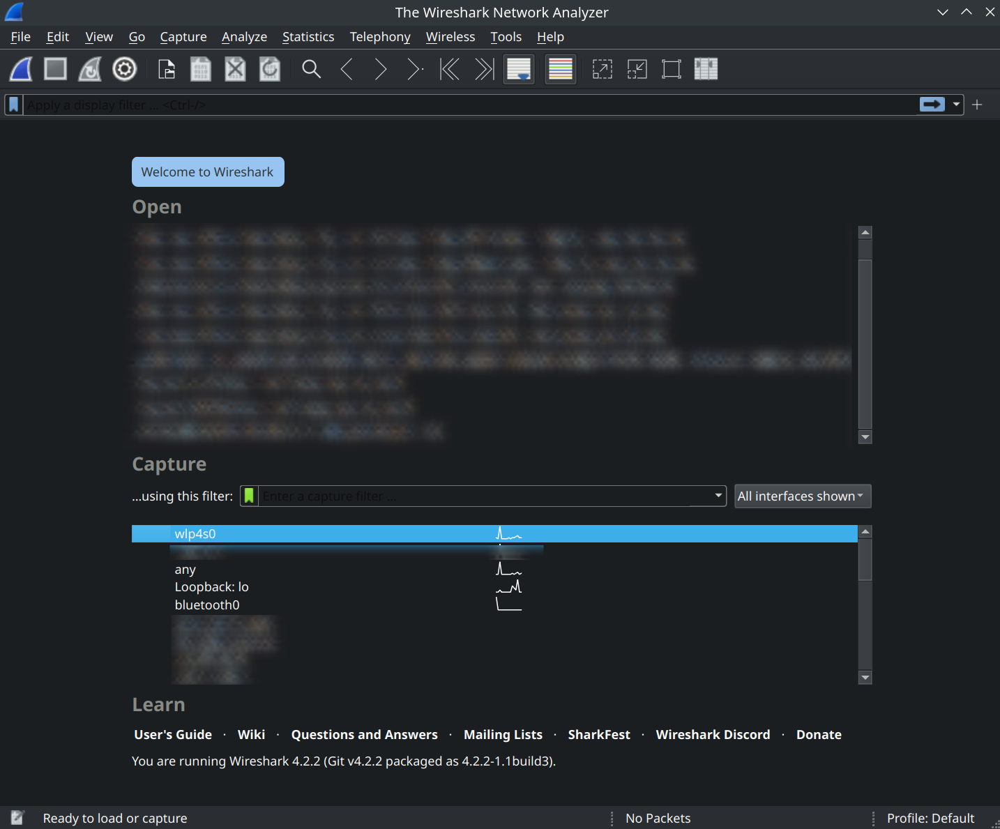
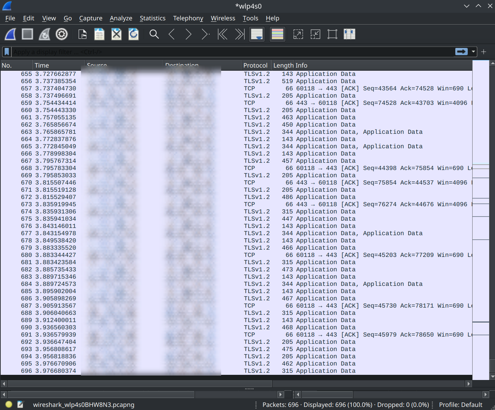

# First steps: Getting samples, info and packets

And just like that we're finally at the gates of ~~hell~~ fun!

I was thinking what to use as an example in this series, and in the end decided to use Need For Speed Underground, since it's a good example for many technics and core ideas. The downside of this choice is that game is rather simplistic in nature, so there won't be a lot of advanced RE stuff to show, but it's a good and approachable game.

And so let's try to apply everything we talked in previous chapters to a real life example

# Getting samples

We installed a very legal copy from our own disk of NFSU. Then we try debugging.games and hiddenpalace.org. Sadly, there are no usable samples. But there are existing servers (https://github.com/HarpyWar/nfsuserver), which will aid us with this task.

This makes this game a "bad case scenario" where we operate with no symbols, existing code of unknown quality and the game binary. But fear not - NFSU was picked for this exact reason, since it's a pretty simple game.

# Doing the research

This is hard to be done from zero, since your knowledge is non existent about this topic. So let's do it in a manner where I do it "from zero" first, and then I'll talk about historical stuff.

## Analyzing the code

From brief look at `server.cpp` we can see a couple of replies and reads for the packets

```C++
void ServerClass::SendRoomsToUser(UserClass* user, char* buffer) {
	RoomClass* tmp;
	tmp = Rooms.First;
	while (tmp != NULL) {
		if ((tmp->Count > 0) || (tmp->IsGlobal)) {
			sprintf(arr2[0], "I=%u", tmp->ID);
			sprintf(arr2[1], "N=%s", tmp->Name);
			sprintf(arr2[2], "H=3PriedeZ");
			sprintf(arr2[3], "F=CK");
			sprintf(arr2[4], "T=%u", tmp->Count);
			sprintf(arr2[5], "L=50");
			sprintf(arr2[6], "P=0");
			if (user->Connection != NULL)
				user->Connection->OutgoingMessages.AddMessage(MakeMessage(buffer, "+rom", arr, 7));
		}
		else {
			sprintf(buffer, "Error:Room empty\n");
			if (Verbose) Log(buffer);
		}
		tmp = tmp->Next;
	}
};
```

Seems like packets payload is text based, and packets has "tasks" marker in form of 4 bytes values like `+rom`.

From data in in `client.cpp` we can see domains of `ps2nfs04.ea.com` being called, and the rest of the code, purpose of which is not too clear.

So now we know that we need to redirect `ps2nfs04.ea.com` to `127.0.0.1`, and that's a good enough start for now.

## Historical stuff note

NFSU online backend predates EAs next solution FESL, which shares a lot of core ideas with NFSU online protocol. Main points of both protocols is that they're human readable, instead of being raw bytes, and all calls has a "task" name, like `move`, `gjoi` `+who` and others.

Structurally, packets are pretty simple, has hardcoded fields and in general there logic regarding all of them is transparent and it's easily searchable via decompiler. But let's forget that I said it right now, and get back to working on the implementing the server

# Figuring out where packets are being sent

Since learning other people code without any base to actually understand their decisions is thought, let begin getting said packets. As you already know (or at least should) there are 2 main transport protocol used by the games: TCP and UDP. In 90% of cases you would see TCP. You also must remember that games in 95% of cases would keep target server as a DNS name, not an IP.

To setup a capture environment we first need to:

- Figure out were packet is being sent 
- Figure out which port is utilized.

There are generally 2 ways to do it:

1) On Linux (and Windows + Mac): Use Wireshark and do it manually 
2) Or if you're using Windows: procmon

## Wireshark way

This approach is more universal but at the same time doing it first time is tougher than using procmon. But by "tougher" I mean that it will take maybe additional 30-60 minutes to figure everything, instead of using procmon. But let's do it first and compare those 2 approaches later.

### Step 1: start capture

We open up Wireshark (which you should already have at this point) and present with this window



Here we select our internet facing interface (in my case `wlp4s0`) and we should begin seeing all outgoing and incoming packets 



Now we're listening to all packets, which we obv don't need. But we'll get to filtering later.

### Step 2: getting DNS request (or not)

> This step is a little bit tricky. Since we're using NFSU as an example and we do know already it's using a DNS name, we should be looking for one. But there are some cases where this is not a case and game will use an IP. So to simplify it here I'll do it via DNS approach, and just state that this is not an universal approach and you should be prepared for things behaving differently.

So with ongoing packet capturing we launch the game and navigate to online option.


% SCREENSHOT 1 %

So with this we potentially triggered a DNS name resolution, which we should see in Wireshark with a filter of `dns`

% SCREENSHOT 2 %

Good, so with this we confirm that game in fact utilize domain of `ps2nfs04.ea.com`, which is failing to resolve.

With this knowledge we add this domain to hosts file, which is located at `/etc/hosts` in Linux or `C:/Windows/System32/drivers/etc/hosts` in Windows, where we add a record of

`127.0.0.1 ps2nfs04.ea.com`

now we need the port

### Step 3: getting port

Now we stop capturing at outgoing interface and switching to local interface `loopback`.

% SCREENSHOT 3 %

And restart the game, since in most cases DNS resolution is happening only once in game lifecycle. It's not a rule, but just to be sure. And mentally prepare us to non stop restart which are awaiting for us in the future.

Navigate to online menu, try to enter it again, and we should get a failed connection attempt to `127.0.0.1`. This should look something like:

% SCREENSHOT 4 %

or you can use a filter of 

```
