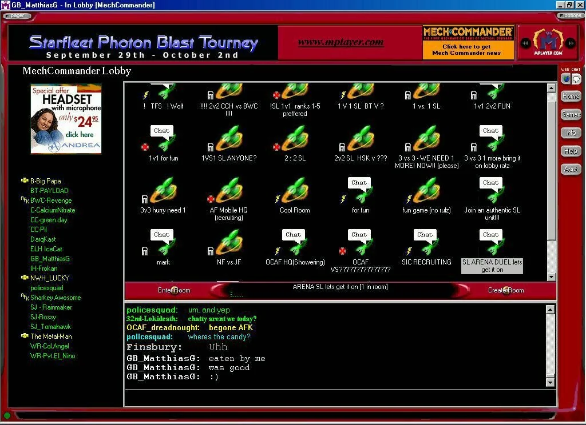
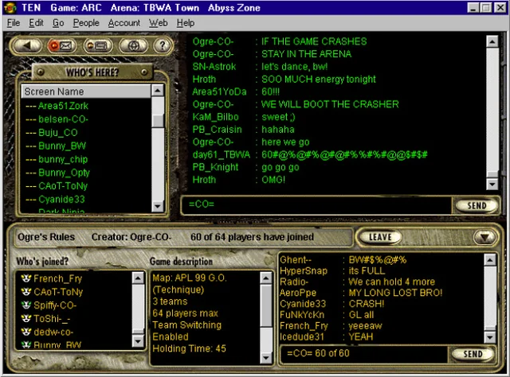
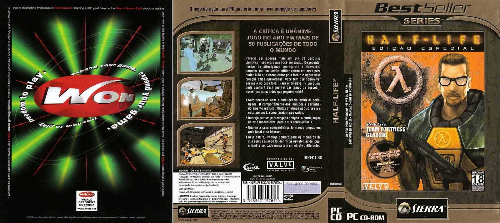
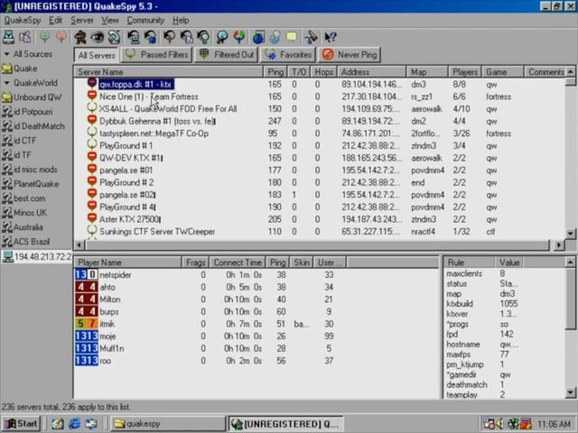

# Unknown world of online middlewares

> This is a public version of my huge write-up about history of Online Network Middlewares. While it's a less of a technical write-up, than a pop-science piece, it serves as a great starting point for curious people about the field. Plus it's an ongoing effort to document stuff hidden in shadows, for historical purposes. 

> Migration from Google Docs is an ongoing effort, so 

Hi, my name is Aibot. And for the past several years I together with several other bright individuals have been researching a very obscure topic of online network middlewares. If you ever played an online game in the past 20 years, there is a good chance you encountered at least one of them. But people usually never ask themselves “Hey, how does this game handle profiles?” or “How does matchmaking work?”. So, I decided to write a comprehensive analysis/tell a story about the mostly unknown world of network middlewares. With some conspiracies, technical analyses and whatnot included.

## What is online network middleware

To start our story, let’s first define what online network middleware is. 

Online network middleware is a set of high-level entities and abstractions that define how a game communicates with persistent data storage aka master server, which contains info about game sessions, user progression, leaderboards and everything else imaginable.

Besides the primal function of data storage and retrieval, network middlewares might solve issues of network connectivity between clients and have anti cheat/piracy checks.

Usually, online middleware would be bundled as a reusable set of libraries, which developers would integrate into their game.

It also should be noted that online network middleware (usually) don’t take part in a player to player, or player to server connection, since those things are implemented using different protocols. There are some deviations to this rule, but for now let’s assume that this claim is true.

# The beginning
It’s somewhat hard to pinpoint the exact date when all of it started, since the answer will depend on who you ask.

- Some people will tell you it all started with Steam. 
- Some would say that Xbox Live on OG Xbox was the starting point for massive online gaming.
- Some would mention that Dreamcast had broadband support before OG Xbox was even released.
- Some very old people would remember playing online via MPlayer or WON.
- Some would mention Teleplay.

But we’re not interested in being able to connect to the internet per se, we’re interested in playing multiplayer games together with random people online and making some number in some db go up.

Potentially the very first thing that (although, with a very huge stretch) falls under “Online Network Middleware” description happened in 1991.

## The Sierra Network, or where it all began

In 1991 a well known back then Sierra Entertainment launched “The Sierra Network” or TSN. Presented as a "cyberspace theme park" TSN would include online avatars, mail system and some basic games like chess, checkers, bridge, and backgammon. And a LarryLand, which in Sierra's fashion was an “online bar” with virtual kisses and chat system.

But the main star of the show was The Shadow of Yserbius, a multi-user dungeon with GUI and RPG system. As close as it gets to what we usually call “MMO” those days. 

As I mentioned, it’s a big stretch to call online avatars and a single bundled RPG an “Online Middleware”, but the core idea was there. Sure, the main idea of the TSN wasn’t “provide developers with a solution to add online functionality to their game”, but TSN inspired a lot of competition to begin looking into the “online gaming” side of that funny novelty called “The internet” and creating a real “Online Network Middleware” solutions.

So The Sierra Network, while not falling under the term “Online Network Middleware” in general sense since “Middleware” part is missing, it’s server as a great starting point.
90s and initial attempts to gather gamers at one place.

As I mentioned, TSN sparked a lot of competition. And that competition finally brought what was a first true Online Network Middlewares. But with a very specific, 90s spin. Unlike later implementations of a concept “Libraries to connect games to an online backend” those were more of “Apps to find other players and servers”. Sure, some of them provided libraries for online stuff, but generally it was closer to Steam as we know it now, than to b2b services they’re now.

I want to apologize in advance to the reader, since this era is not researched by me with hands-on approach, as others middlewares I’ll talk about, but with “Wikipedia and obscure game forums” approach. So some information could turn wrong or lacking. 

## Mplayer (1996-2000)

MPlayer was an “online PC gaming service and community”, which was playing a role as a service provider for games online connectivity, and an application for finding other players, chatting and VoIP communications.  

Not much research has been done about it, and at this day we have somewhat scarce remnant files in published source code of some games (https://github.com/willtate/whaven2/blob/master/SRC/mplayer/MGENVXD.H and https://git.clss.pl/externals/CnC_Remastered_Collection/-/blob/master/REDALERT/MPLIB.CPP )

But hey, profiles, stats, chats, tournaments, communication with master server - all the important stuff is here.

In 2000 after 4 years of work, MPlayer was purchased and integrated into GameSpy.

## Heat.net (1997-2000)

Pretty much the same premise as MPlayer.com (also utilizing their tech under license). Absolutely zero info about it online, no code and no research of any kind.

## Total Entertainment Network (1995-1999)

Again, same stuff, different app. According to Wikipedia, “Total Entertainment Network was the first online gaming provider to go live.” This claim is probably true, if you neglect The Sierra Network and many internet based dungeon games existing prior to it, but again, the topic is really hard and definitions are not too concrete.

## MSN Games (Zone.com) (1995-...)

If something exists, Microsoft probably tried their hand with it.

MSN Games had multiplayers games, profiles AND actually provided matchmaking service though their platform in games like Midtown Madness, Age of Empires, Flight Simulator 98, Star Wars Galactic Battlegrounds and Jedi Knight. Which makes it a very real and very true to the concept of Online Network Middleware.

From a developer perspective it was never researched, as all of its peers of that time, leaving details about its internals a secret to this very day.

## World Opponent Network (1996-2008)

Oh, this one is very curious.

You probably don’t know, but initially the publisher for Half-Life 1 was Sierra Entertainment. It’s unthinkable today to imagine Half-Life 1 being not part of Valve and Steam, but that’s how it was back in a day.

Back in 1996 Sierra On-Line created World Opponent Network. And early versions of Half-Life, Counter Strike and Team Fortress Classic were not only distributed though it, but also had their online working thought WON. Later Quake and Activision titles joined WON, but not for online part, but as a part of their online distribution platform.

Sounds awfully like Steam we know today, right? Well, in 2001 Valve decided that WON is a great idea, but needs some Valve spin on it, so in secrecy they begin working on a WON replacement, which was released as “Steam” in 2003. Oh and in 2001 Valve bought back rights for Half-Life from Sierra.

In sequential years, a lot of games would move from WON to other service providers for online, which would lead to its death in 2007 and closure in 2008.

It’s funny to think how different things could be without Steam, but thanks to WON, we now have it. For better, or for worse.

## QuakeSpy, or where GameSpy began

Quake with an addition of QuakeWorld opened a world of online multiplayer games to many, was present on all mentioned above services and in general was a game of the generation. Quake itself was so popular, that the specific tools for its online services were created left and right.

And In the late 90s Mark Surfas would create a QuakeSpy, a software to query the QuakeWorld master server.

QuakeSpy would be the beginning of Mark Surfas career, who in 1997 would create a company GameSpy. Yes, that GameSpy.

# 2000s and the rise of “The Big 3”

After all that rumblings about 90s, we’re finally in the year 2000. As you could note, a lot of services died before that mark. Failure to secure an exclusive rights to a title (unlike WON) and lack of profits for nearly all of them resulted in a landscape of WON and pretty much no alternatives. But our story had just begun.

In the 2000s, we will see a boom of online gaming. Counter Strike 1.0, Quake 3, Neopets, Diablo 2, NFS Underground. Playstation 2 (and Dreamcast!) with dial-up support, with original Xbox joining them later on.

Developers all around the world wanted to add some form of multiplayer to their titles and not spend valuable resources on reinventing the wheel.

A lot of companies, startups and university students will see this as an opportunity to release their “Online middleware” solution to the market.

But as a researcher, who has the privilege to write about them from a 20+ years perspective, I would probably note only 3 of them.

- GameSpy
- Quazal
- Demonware

As we go further, those 3 will be referred as “The Big 3”, due to their impact on the landscape of things. While to an average gamer out of those 3 only GameSpy will ring the bell, I can assure you, the rest 2 also play a huge, if not bigger role, than GameSpy. All of them would shape the current online gaming landscape like we know it today, play a role in the biggest online titles of its time, and stay relevant to this very day.

Of course, there were others, less successful and known online network middlewares. Tincat is probably my favorite example of this. This obscure online middleware would be used in Settlers and Sacred series of the games. And UDPSoft. Don’t confuse it with Ubisoft, but Ubisoft would actually use UDPSoft a couple of times.

There are also EAs solutions, but those were never available outside of EA published games, and so they deserve their own mention later on.

And I also can’t skip mention of console-specific online stuff, like Xbox Live and Sony’s Medius.

## GameSpy

Who doesn’t know GameSpy! Gamers and developers favorite online solution for matchmaking, present in a ridiculous number of games (800, according to Wikipedia).

GameSpy, as mentioned, would start as a company in 1997, combining their media business and online network middleware endeavor.

I would be honest with readers and confess early on that I personally never worked with GameSpy directly. I’ve read a lot of technical analysis, reverse engineering articles (I highly recommend reading Keowu's article about the topic) and researched its code, but my direct knowledge on GameSpy and its history is rather limited.

Furthermore, I personally think that GameSpy success is related to 2 titles - Battlefield 1942 and Halo. Those 2 would massively contribute to GameSpy adoption and popularity. Extra kudos should be dedicated to their marketing team, making sure everyone at the very least heard about GameSpy.

From the tech side of things, not much can be said about it. It’s a TCP based solution, slightly resembling HTTP.

## Quazal

Oh, Quazal. Out of all 3 it’s probably the least known one. If GameSpy is notorious for being itself, and Demonware is known to some, Quazal is absolutely unknown and at this point in time mostly forgotten. There are very few people out there working on Quazal itself, a slightly bigger number of people familiar with its tech, and exactly one publicly available implementation of it.

If you decide to search for Quazal, you will find some articles. One of them would include a very “modest” description, which I personally love.

“In 2000, Quazal revolutionized network programming by rendering obsolete the traditional packet/socket paradigm.”

This quote is hilarious, if you actually worked with Quazal, since there is nothing revolutionary about it. Out of The Big 3 Quazal the only one working via UDP, or how they called it “PRUDP” or “Pretty Reliable UDP”. Behind closed doors, we call it “Crappy TCP”.

On paper, PRUDP is nothing more than a complete TCP reimplementation on top of UDP. Think resends for missing packages, reconstruction of out-of-order packages, and so and so. Quzal wasn’t even the first to come up with this idea, nor the only piece of software utilizing such an idea, even back then. But we would be fair to Quazal and agree that out of The Big 3 their ideas would differ from the rest. A tiny bit. The core idea of Online Network Middleware would be absolutely the same.

## Demonware

Demonware is my favorite, out of all 3. And the one that got me into this hobby, so I can talk about it for hours.

The fun thing about Demonware, that the name of the middleware is actually “Matchmaking plus”, and Demonware is the name of the company. And “Matchmaking plus” itself would be a part of their BitDemon series of products. But to save you from remembering this naming mess I’ll refer to “Matchmaking plus” as Demonware. BitDemon and “Matchmaking plus” will eventually get fused together and will change its name to Demonware internally around 2012-2014, so such a thing is not only appropriate, but also technically correct.

In 2003, a group of graduates from Ireland decided to continue their graduation project of “games p2p connectivity solution” into a standalone product, called “BitDemon”. And provide a set of libraries for said solution, and as well as master server hosting for their clients.

There is little to none known if BitDemon was ever used commercially. So after BitDemon they made a Matchmaking Plus, as a tie-along online network middleware and this one actually able to make a landing. Their very first commercially released title with Matchmaking plus would be the Starship Troopers video game, released in 2005 by Strangelite.

This will kickstart Demonware as a company, and resulted in Demonware being used in over 100 titles, for all platforms known to man, from ps2 to ios. I’m getting a bit ahead of myself, since the Demonware story wouldn’t happen without Activision, but we’ll get to that part pretty soon.

Initially, Demonware consists of 3 parts:

- STUN/NAT Punching service
- Auth server
- Master server, or how it’s called internally, LSG server.

Overall, I can call Demonware's design approach and philosophy as “solid”. While I could spend the rest of this document describing every part of the Demonware, such a thing deserves its own write-up, so I’ll skip doing it here. This is a story about them in general, and not a “Demonware deep dive”.

One thing that is curious about Demonware, is a lack of any publicly available info about it. If you decide to learn more about it, you would probably meet with a lot of nothing. It’s not as bad as Quazal in this department, but the topic is still extremely obscure. But once you know what to look for, you quickly find out that Demonware is all around you, and you probably played at least one game with it.

# Seventh generation of consoles, p2p and NAT

The Seventh generation of consoles is often referred to as a golden age of gaming. PCs were pricey and underpowered, so everyone would own either Xbox 360, PS3 or Wii. This also was the time when hosting providers were still in early stages and not as wide-spread.

Online gaming, primarily born on PCs, would usually mean that a dedicated server would be bundled with the game, so players themselves would figure out how to run a server for other players to connect. Now, you just press play and get into a gaming session, hosted by the developer/publisher. Back then, such a thing was not as common. It was up to the player to find a server/session via services to play.

A later iteration of such approach would be a “Game server hosting providers”, which are mostly non-existent now, aside from minecraft, Rust and some other titles. But back in the day, you could rent a server for Bad Company 2 or Quack Wars: Enemy Territory, and control it via web UI.

Such public and not public dedicated servers would still integrate with online network middlewares, reporting about their state and existing in a global pool of available sessions.

“But what about titles with no dedicated server?”, you might ask. And that’s where the combination of all the factors above create an interesting situation, which resulted in a P2P, or listened server approach being the standard.

I’m lying a bit, when I say that this idea was born in the 2010s, since the idea of “client also acts as a server for other clients” predates even Doom itself, but in six generation of consoles this idea would become the go-to solution for pretty much all the online titles, and in seventh generation it continues to be the main approach for online play.

You would log in into the game online mode, which is backed by its online network middleware, and host a session, to which other players connect. The amazing on-paper solution, with no need for dedicated servers hosted by the developer/publisher, was met with the harsh reality of a steadily growing networking issue of NAT.

NAT, or Network address translation, was created as a solution to hide many devices behind the same IP. If in the early days of the internet you had a good chance to have a dedicated ip address with open ports, internet service providers quickly realized that a typical user doesn’t need such things. And so internet service providers begin to hide thousands of clients behind one IP, limiting an ability for direct P2P connection to be established.

And here comes the NAT Punching! The basic idea is simple - 2 clients begin to establish a UDP connection on a selected port, which makes all the devices along their network connection to directly pass through UDP traffic between them. Since NAT punching can only be done via UDP, all online network middlewares had a separate NAT punching UDP service for such tasks. Except for Quazal, since it being UDP based, it included NAT punching service directly into it.

But in modern day and age, and the rise of C-NAT, which doesn’t work with NAT Punching, resulted in connectivity in such games degrading by a lot. Mobile hotspots are notorious for this, but common landline ISPs are also beginning implementing C-NATs, which continue to break things even further.

This, as well as a rise of IPv6, which games of that era doesn’t support, is a big threat to keeping those games playable. Maybe not today, or anywhere in 5 to 10 years, but one day those games might become unplayable. But that’s a worry for another day.

With P2P, NAT and NAT Punching in mind, let’s continue our story.

# Later 2000s and the end of many

We made a big detour with NAT and P2P explanations, but it would be really important later on, believe me.

But let’s get back on track with our story and out The Big 3, shall we?

Around 2008 we got into a pretty well established market of Network Online Middlewares. GameSpy is everywhere, and powering the entire Wii console. Xbox Live is a craze with its Arcade. PSN is being hacked. Demonware is getting included into big titles from Activision and Ubisoft and many others. Quazal exists in the shadows. EAs making waves with each release.

Network online middlewares were growing in features, with now seemingly each game having its own online mode, progression, leaderboards, ranked mode, powered by one tech or another.

But I promised to tell you a comprehended story about the unknown, and it won’t be complete without taking a good look at each of those companies, starting with Demonware. And Agora!
Agora, Ubisoft and Demonware

Even now, we don’t know all the details about Agora. It’s a rather mysterious entity, but it surprisingly plays a big role in Demonware history. My searches for anything definitive about them fall short, minus one interview, that is now gone from the internet and web archive.

Agora is a Canadian based company that somewhere around 2005-2006 bought Demonware 1.0 tech, and later Demonware 1.8. With Demonware as their base tech, they made a so called “Agora toolbox”, that would use their own auth flow, and Demonware protocol for the master server, with some additional tooling to generate entities.

So far, we’re only aware of their only one client - Ubisoft. And so Agora would be responsible for online in their titles. This resulted in a funny situation, where Demonware technically is present in titles like Vegas 1 and 2, Far Cry 2, Endwar, Hawx and some others, while on paper they have no ties to Demonware.

After their last title with Ubisoft, HAWX, Agora fell into obscurity and seemingly ceased to exist. This is probably linked to a particular event that would happen to Demonware in 2009, but we’re not there yet.

I tried to track down Agora developers via game credits (thanks, Mobygames!). 2 lead programmers from Far Cry 2 credits, Marc Demers and will continue to work in Ubisoft in online teams for various titles. The rest of the programmers will also become a part of Ubisoft. My favorite of them is probably Denis De Andrade, who began his journey with Far Cry 2 in 2008, and got a position as Online Technical Lead 14 years later. Sadly, the title where he finally got a position as Online Technical Lead would be Tom Clancy's Rainbow Six: Extraction, and we all know how that title went.

I’m not sure if it’s fair to say that Agora actions contributed to Demonware success as a company, but we’re still grateful to them for using Demonware, since Agora usage of their tech contributed massively to being able to preserve Ubisoft titles from that era.

Another thing worth mentioning is Agora's work on Tom Clancy's Endwar. This seemingly obscure title contains a “Theatre of War” online game mode, which is basically a global turf war, with 3 factions competing for world domination in a turn basis, each turn taking one real time day. Agora built a unique service for it on top of Demonware protocol, which is as massive as it’s complicated. Adding support for Endwar took us 5 months of work, and it’s probably the most complicated Demonware 1 title we ever worked on.

## Demonware in later 2000s

Demonware got a lot of traction, working on a lot of titles of that era. Grid, Guitar Hero 3, The Club and many others.

But what truly gave them wings was a lot of Activision support. Their first Activision title would be Call of Duty the Big Red One for PS2. After that they would be included in most Activision titles with online mode in it, until the faithful year of 2007 when Call Of Duty 4 was released.

This release was massive for Demonware. If you want to learn all about it, there is a presentation called “Erlang and First-Person Shooters” available for viewing here telling a lot about Demonware history of those days. Basically with Call Of Duty 4 Demonware transformed from a relatively unknown force in the online middleware market to the biggest player overnight.

While that presentation states that Demonware was purchased by Activision in 2007, this acquisition won’t become official until 2009. We suspect it was due to the contracts with Agora and some other publishers, but we’re speculating here. But one way or another, this acquisition stopped Demonware from being able to provide new contracts for their tech, and begin their full devotion to Activision and their games. Each and every Activision titles since 2010 would utilize brand new Demonware tech, Demonware 2.0. The list of titles using the same Demonware online middleware is simply massive, counting 100+ titles, with 80% of them being released in the 2010-2015 period, until Activision went full Call Of Duty.

We’ll get back to Demonware in next chapters, but for now, let’s pay some respects to Quazal.

